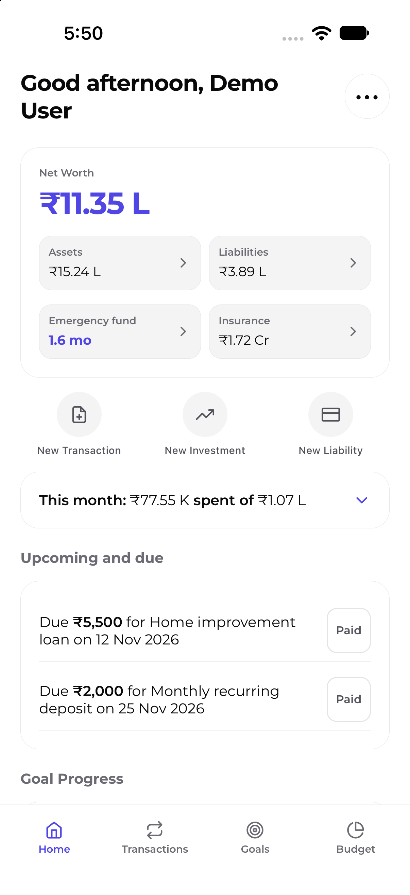
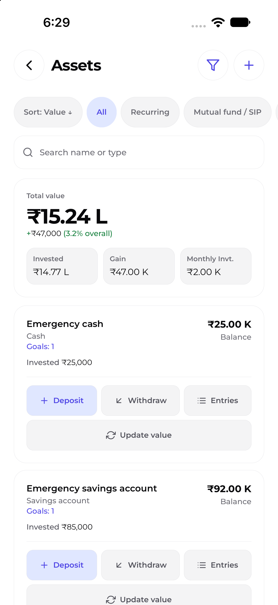
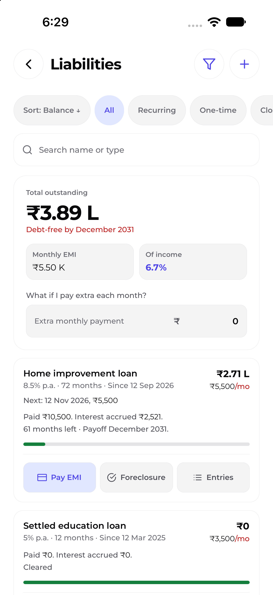
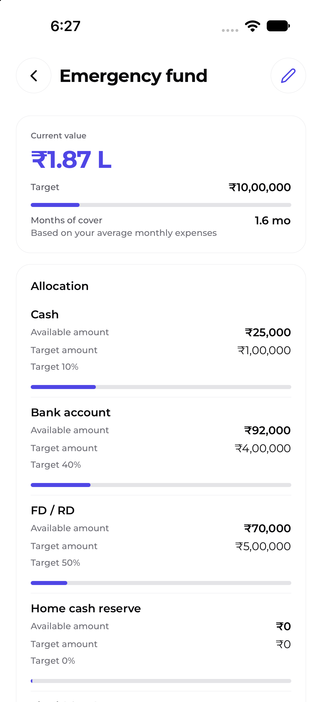
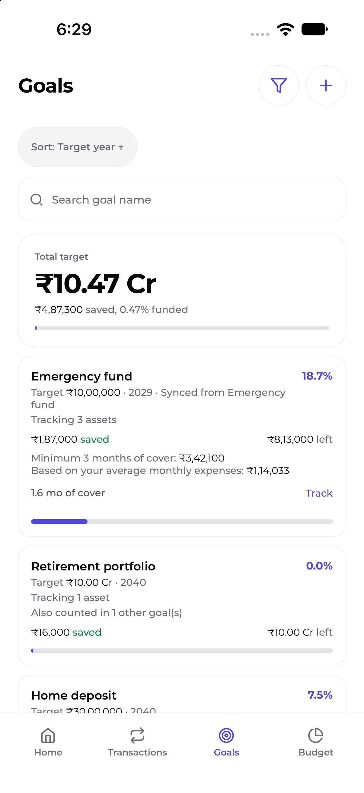
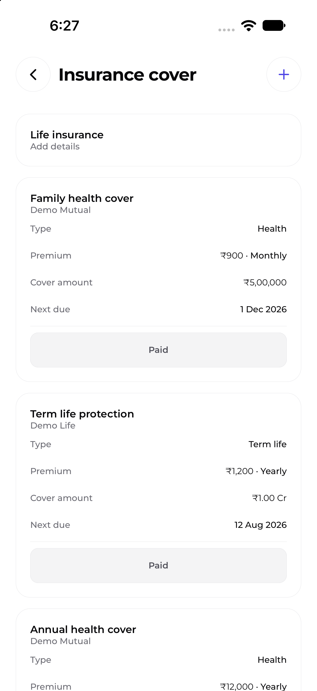
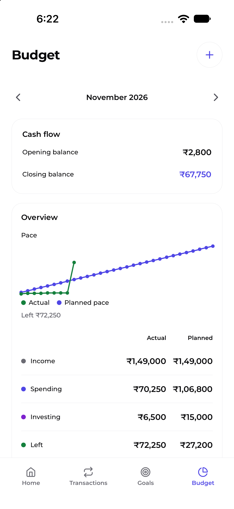
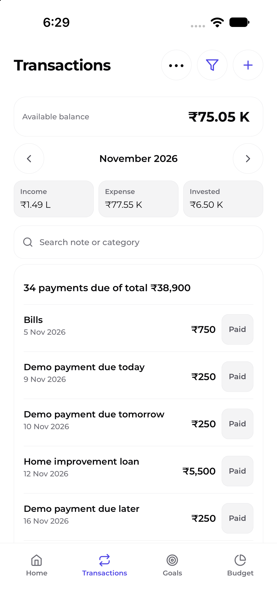

# WealthWise

WealthWise is an offline-first personal finance app built with Expo and React
Native. It keeps application data on the device and makes no cloud or network
requests at runtime.

## Contents

- [For users](#for-users)
- [Features](#features)
- [Download](#download)
- [What's new in v1.2.0](#whats-new-in-v120)
- [Screenshots](#screenshots)
- [Data and privacy](#data-and-privacy)
- [Limitations and disclaimer](#limitations-and-disclaimer)
- [For developers and contributors](#for-developers-and-contributors)
- [Getting started](#getting-started)
- [Commands](#commands)
- [Project structure](#project-structure)
- [Branching and commits](#branching-and-commits)
- [Gates](#gates)
- [Release process](#release-process)
- [Documentation](#documentation)
- [Architecture and data](#architecture-and-data)
- [Calculations](#calculations)
- [Valuation](#valuation)
- [Insurance](#insurance)
- [Schema and migrations](#schema-and-migrations)
- [Memory docs](#memory-docs)
- [License](#license)
- [Brand assets](#brand-assets)

## For users

### Features

- Home overview of net worth, account balances, Emergency Fund progress,
  Insurance cover and scheduled dues.
- Income, expense and investment transactions, with linked holding and policy
  entries where supported. Transactions keeps month selection and cash-flow
  balances without a Review-month link.
- Manual and planned investments, investment-entry history, and recurring and
  one-time liabilities with payment tracking. Recurring investments can be
  stopped and resumed; liability cards and details consistently use
  Foreclosure.
- Monthly budgets with spend/invest sections, income schedules, due tracking,
  and cash-flow views. Income can recur monthly, quarterly, half-yearly or
  yearly, or be scheduled once.
- Real estate and named Custom financial types are available for holdings;
  liabilities also support named Custom types.
- Completed loans and achieved goals appear in separate, initially collapsed
  sections.
- Savings goals, goal-linked assets and an Emergency Fund with editable
  allocation items.
- Editable Insurance policies and scheduled premium dues.
- Local reminders, optional device-authenticated app lock, and locally stored
  theme preferences.
- Local backup export and restore with schema validation and integrity checks.
  Encrypted backup export is available with a passphrase.

## Download
Latest version: v1.1.1
Release date: 2026-11-09
- [Download the latest Android app (v1.1.1)](https://github.com/sahilsheikh-dev/WealthWise/releases/latest/download/WealthWise-android-latest-v1.1.1.apk)
- iOS: Distribution is not offered.
- [Click here to check older versions](https://github.com/sahilsheikh-dev/WealthWise/releases)
To install the APK, allow installs from this source in Android settings when prompted. This is a direct APK, not a Google Play Store-signed app.

### What's new in v1.2.0

The stress-tier picker supports four choices; Budget Overview removes
redundant summaries while retaining accessible descriptions. WealthWise adds
Real estate and named Custom financial types, once-only Budget and insurance
dues, completed-loan and achieved-goal sections, and an About page with a
confirmed browser link to the latest release. See the
[v1.2.0 release notes](docs/releases/published/v1.2.0.md).

### Screenshots

<table>
<tr>
<td><a href="docs/releases/screenshots/v1.1.1/WealthWise-v1.1.1-screenshot-home.png"></a></td>
<td><a href="docs/releases/screenshots/v1.1.1/WealthWise-v1.1.1-screenshot-assets.png"></a></td>
<td><a href="docs/releases/screenshots/v1.1.1/WealthWise-v1.1.1-screenshot-liabilities.png"></a></td>
<td><a href="docs/releases/screenshots/v1.1.1/WealthWise-v1.1.1-screenshot-emergency-fund.png"></a></td>
</tr>
<tr>
<td><a href="docs/releases/screenshots/v1.1.1/WealthWise-v1.1.1-screenshot-goals.png"></a></td>
<td><a href="docs/releases/screenshots/v1.1.1/WealthWise-v1.1.1-screenshot-insurance.png"></a></td>
<td><a href="docs/releases/screenshots/v1.1.1/WealthWise-v1.1.1-screenshot-budget.png"></a></td>
<td><a href="docs/releases/screenshots/v1.1.1/WealthWise-v1.1.1-screenshot-transactions.png"></a></td>
</tr>
</table>

### Data and privacy

Application data is stored locally on the device; there are no user accounts
or runtime cloud synchronization. Backup files are created only when the user
exports them. Encrypted export is the default and protects the exported file
with a passphrase; the passphrase is never stored, and a lost passphrase
cannot be recovered. Plain export is unencrypted and clearly warns before
sharing. A backup integrity digest is not encryption or authentication.

Backup encryption protects exported files only. App data stored on the device
remains unencrypted; an app lock or device authentication is not encryption.
Picked files use a temporary cache copy for reading and are removed
afterward. The plaintext result of decrypting an encrypted backup is never
written to a temporary file. Operating-system backups may include app data
according to platform settings.

### Limitations and disclaimer

- Local reminders cover up to 60 nearest dated dues and refresh when the app
  opens, returns to the foreground, or relevant data/settings change. A long
  gap without opening the app may leave the reminder window empty.
- Native reminder delivery may require a development or production build for
  device validation.
- WealthWise is not financial, tax, legal or insurance advice. Insurance
  cover multiples and similar figures are planning guidelines, not a judgment
  of adequacy or a recommendation.
- The production dependency audit has recorded advisories. Major Expo/Router
  upgrades require separate review and approval.

## For developers and contributors

### Getting started

Use Node.js 26; `.nvmrc` selects 26.13.0 and `package.json` permits
`>=26.0.0 <27`.

```bash
nvm use
npm ci
npx expo start
git config core.hooksPath .githooks
```

### Commands

| Command | Purpose |
|---|---|
| `npx expo start` | Start the Expo development server. |
| `npm run ios` | Run on an iOS simulator/device using the local native toolchain. |
| `npm run android` | Run on an Android emulator/device using the local native toolchain. |
| `npm run web` | Start the web development server. |
| `npm test -- --coverage` | Run Jest tests and collect coverage. |
| `npx tsc --noEmit` | Run TypeScript without emitting files. |
| `npx expo lint` | Run Expo lint. |
| `npx expo-doctor` | Check Expo project configuration and dependencies. |
| `npx expo export --platform android` | Export the Android JavaScript bundle. |
| `npx expo export --platform ios` | Export the iOS JavaScript bundle. |
| `npm run build:branding` | Regenerate branding assets. |
| `npm run check:assets` | Validate generated/committed branding assets. |

`npm run reset-project` is a destructive Expo starter-template reset; do not
run it on this application.

### Project structure

- `app/` — Expo Router routes and the four tab screens.
- `src/domain/` — types, schemas, migrations and pure financial rules.
- `src/data/` — Zustand store, persistence and data migration.
- `src/components/` — shared UI and reusable form controls.
- `src/hooks/` — application hooks.
- `src/lib/` — shared utilities and platform-facing helpers.
- `src/mock/` — deterministic demo data and tests.
- `src/theme/`, `src/constants/` — themes and application constants.
- `assets/`, `scripts/` — bundled assets and asset-generation tools.

### Branching and commits

Read [CONTRIBUTING.md](CONTRIBUTING.md) for branch prefixes, merge policy,
Conventional Commit subjects, pull requests and contribution guidance.

### Gates

Run all six gates in order and record each exit code:

```bash
npm test -- --coverage
npx tsc --noEmit
npx expo lint
npx expo-doctor
npx expo export --platform android
npx expo export --platform ios
```

### Release process

The current published version is v1.1.0. Follow
[`docs/releases/build-config.md`](docs/releases/build-config.md) and
[`docs/releases/RELEASE_PROMPT.md`](docs/releases/RELEASE_PROMPT.md). A release
updates the README Download and What's new sections and the link to the
[releases page](https://github.com/sahilsheikh-dev/WealthWise/releases).
Release publication, tagging and builds require the applicable owner
authorization.

## Documentation

### Architecture and data

The app uses Expo SDK 57, Expo Router routes in `app/`, and a pure domain
layer in `src/domain/`. Dates and identifiers are injected at the boundary.
Zod validates persisted and imported data. On iOS and Android, Zustand stores
the AppData blob with Expo SQLite; legacy native AsyncStorage remains a
fallback. Web uses AsyncStorage. UI metadata and preferences remain in
AsyncStorage. See [architecture.md](docs/memory/architecture.md).

### Calculations

The holding ledger includes the opening amount and dated deposits and
withdrawals. Displayed Invested is net of withdrawals, floored at zero:

```text
Invested = max(0, opening amount + deposits - withdrawals)
gain = current value + withdrawals - contributions
absolute return % = gain / contributions × 100
```

Multiple cash flows use XIRR; a single lump sum uses CAGR. Annualized returns
are shown only when the first cash flow to valuation date span is at least
365 days. Cash and Savings accounts do not display a return percentage.
Emergency Fund targets use the user-set target with the three-month minimum
retained as a floor. See the calculation decisions in
[docs/PROGRESS.md](docs/PROGRESS.md).

### Valuation

Existing holdings retain their legacy value calculation until a valuation
method is explicitly saved or a value/price is confirmed. Suggestions include
balance, accrual, units-times-price or manual valuation depending on holding
type. Accrual uses actual elapsed days over a 365-day year, stops at maturity
and restarts from the last confirmed value. No market data is fetched.

### Insurance

Insurance is an editable local policy list with scheduled premiums. Supported
frequency includes monthly, quarterly, half-yearly, yearly and custom
intervals; paying a due links the transaction and advances the schedule in
one persisted write. Premium dues are shared across Transactions, Home,
Budget and reminders. See [docs/PROGRESS.md](docs/PROGRESS.md) for migration
and behavior decisions.

### Schema and migrations

The current persisted schema is v23 (`SCHEMA_VERSION` in
[`src/domain/schemas.ts`](src/domain/schemas.ts)). Supported data migrates
from schema v1 through v22, and backup-import compatibility is retained.
Backup import validates data and applies supported migrations.

### Memory docs

AI and contributor context is maintained under
[`docs/memory/`](docs/memory/README.md). The root [AGENTS.md](AGENTS.md)
contains the shared rules for AI contributors; [docs/PROGRESS.md](docs/PROGRESS.md)
is the canonical decision, phase and verification ledger.

## License

This project is licensed under the MIT License. Copyright (c) 2026 Sahil Aspak
Sheikh.

## Brand assets

To regenerate the app icon, Android adaptive assets, favicon, splash marks and
in-app BrandMark images:

```bash
npm run build:branding
npm run check:assets
```

Brand source files are in `assets/branding/`; in-app theme colors are managed
separately in `src/theme/`.
