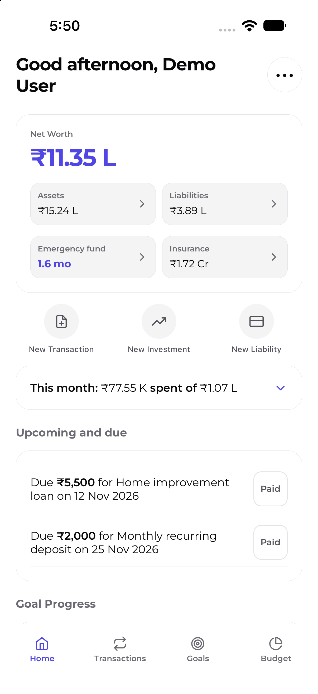

# WealthWise v1.1.1

**Status:** GitHub Release draft created; awaiting owner APK build and upload.
**Release type:** Patch.
**Git tag:** `v1.1.1` (assigned to the draft; tag ref not yet present)
**Previous version:** v1.1.0

## Download

Not available. The owner will upload the APK after building from merged source.

## What's new in v1.1.1

Linked one-time savings marked Paid from Transactions now create the associated
holding entry, and Undo removes it. Shared form controls also display
consistent titles for dropdowns and inputs.

## Screenshots

The supplied screenshot file is identical to those supplied for v1.0.0 and
v1.1.0, as confirmed by the owner. It is attached to the GitHub release draft
as `WealthWise-v1.1.1-home.png`, and the draft body uses its absolute release
asset URL.

## What's Included

### Improvements

- Shared dropdown and input controls display consistent titles.

### Fixes

- Marking a linked one-time savings item Paid creates its holding entry;
  one-step Undo removes the linked changes.

## Versioning and publication

The owner approved this v1.1.1 patch release on 2026-11-09. The application
version is aligned to 1.1.1 and the approved changes are merged to `develop`.
The GitHub Release draft targets the release-branch commit and includes the
screenshot asset. The owner builds and uploads the APK from merged source.
Publication requires artifact/link verification and separate explicit
publication approval.

## Contributors

Release-specific contributor attribution is pending verification against the
approved release commits.
