# WealthWise v1.1.0

**Release type:** Minor
**Release date:** 2026-11-08
**Git tag:** `v1.1.0`
**Previous version:** v1.0.0

## Download
Version: v1.1.0
Release date: 2026-11-08
- [Download WealthWise for Android (v1.1.0)](https://github.com/sahilsheikh-dev/WealthWise/releases/download/v1.1.0/WealthWise-android-v1.1.0.apk)
- iOS: Not available yet. An App Store or TestFlight link will be added when supplied by the owner.
- [Click here to check older versions](https://github.com/sahilsheikh-dev/WealthWise/releases)
To install the APK, allow installs from this source in Android settings when prompted. This is a direct APK, not a Google Play Store-signed app.

## What's new in v1.1.0

Recurring income now appears in planned totals and dues only when it is due,
while other schedules remain editable in a collapsed group. Budget restores
the aggregate Pace graph, linked paid dues keep investment and liability
records in sync, and Entries show schedule progress with collapsed paid
history and dates capped at maturity or the final EMI. Saved value edits also
remain current after an app restart.

## Screenshots

<table>
<tr>
<td><a href="https://github.com/sahilsheikh-dev/WealthWise/blob/main/docs/releases/screenshots/v1.1.0/WealthWise-v1.1.0-screenshot-home.png">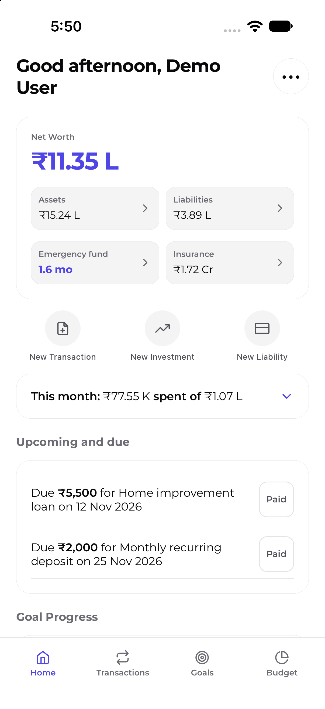</a></td>
<td><a href="https://github.com/sahilsheikh-dev/WealthWise/blob/main/docs/releases/screenshots/v1.1.0/WealthWise-v1.1.0-screenshot-assets.png">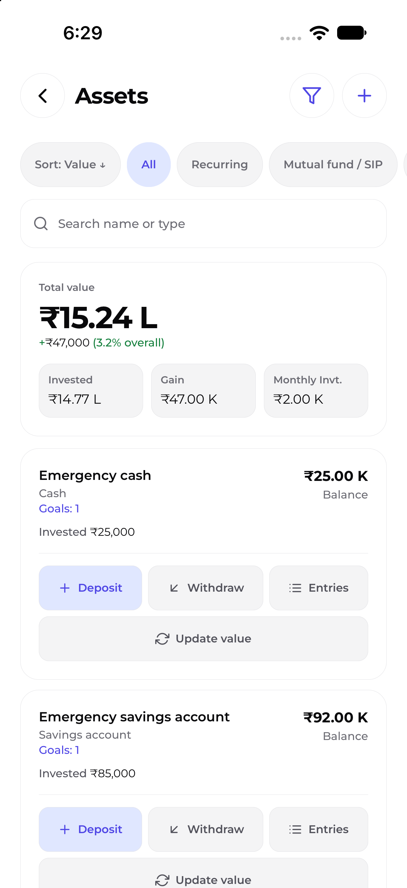</a></td>
<td><a href="https://github.com/sahilsheikh-dev/WealthWise/blob/main/docs/releases/screenshots/v1.1.0/WealthWise-v1.1.0-screenshot-liabilities.png">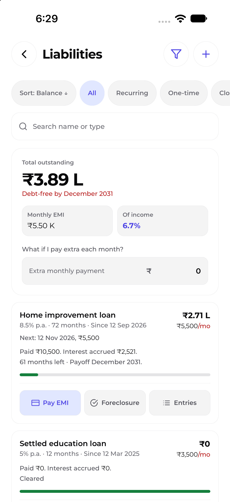</a></td>
<td><a href="https://github.com/sahilsheikh-dev/WealthWise/blob/main/docs/releases/screenshots/v1.1.0/WealthWise-v1.1.0-screenshot-emergency-fund.png">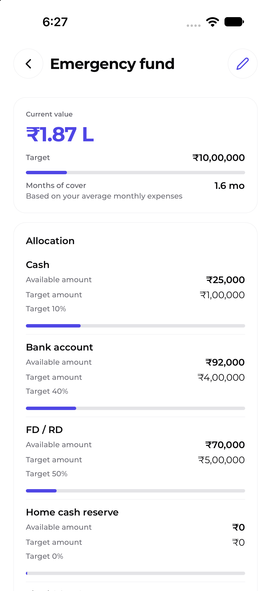</a></td>
</tr>
<tr>
<td><a href="https://github.com/sahilsheikh-dev/WealthWise/blob/main/docs/releases/screenshots/v1.1.0/WealthWise-v1.1.0-screenshot-goals.png">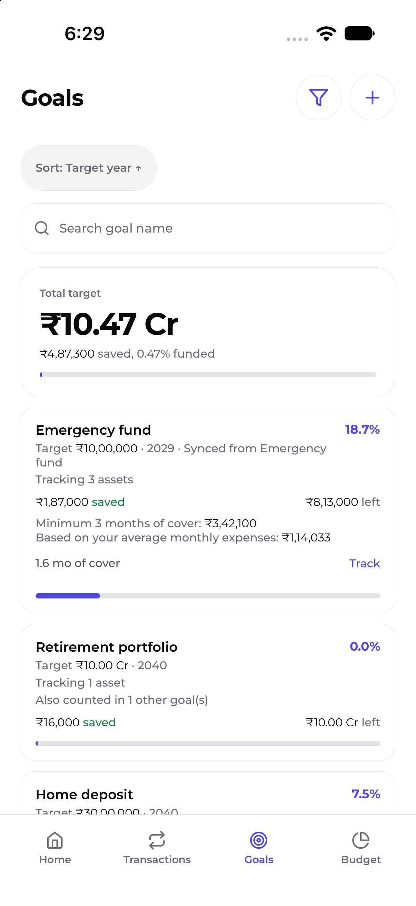</a></td>
<td><a href="https://github.com/sahilsheikh-dev/WealthWise/blob/main/docs/releases/screenshots/v1.1.0/WealthWise-v1.1.0-screenshot-insurance.png">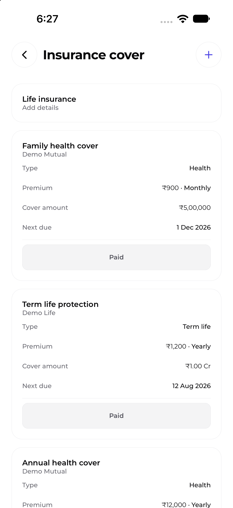</a></td>
<td><a href="https://github.com/sahilsheikh-dev/WealthWise/blob/main/docs/releases/screenshots/v1.1.0/WealthWise-v1.1.0-screenshot-budget.png">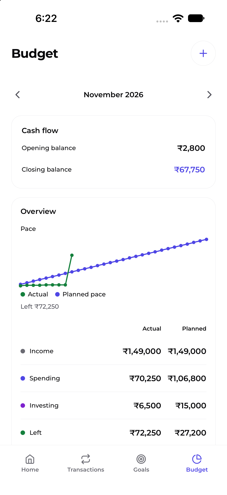</a></td>
<td><a href="https://github.com/sahilsheikh-dev/WealthWise/blob/main/docs/releases/screenshots/v1.1.0/WealthWise-v1.1.0-screenshot-transactions.png">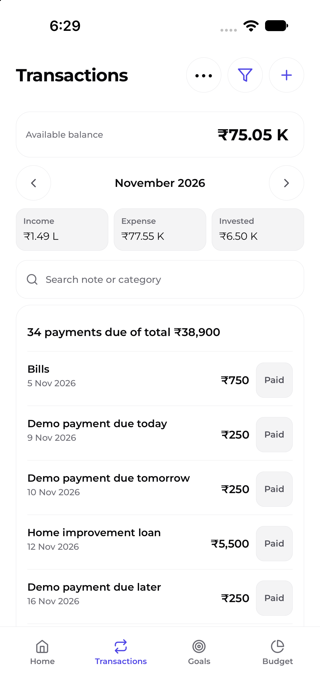</a></td>
</tr>
<tr>
<td><a href="https://github.com/sahilsheikh-dev/WealthWise/blob/main/docs/releases/screenshots/v1.1.0/WealthWise-v1.1.0-screenshot-backup-and-restore.png">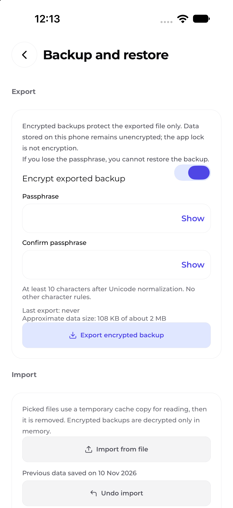</a></td>
<td><a href="https://github.com/sahilsheikh-dev/WealthWise/blob/main/docs/releases/screenshots/v1.1.0/WealthWise-v1.1.0-screenshot-reminders.png">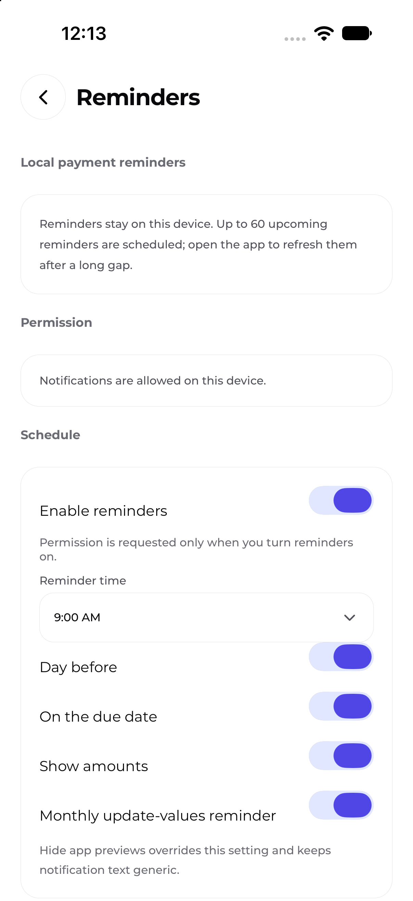</a></td>
<td><a href="https://github.com/sahilsheikh-dev/WealthWise/blob/main/docs/releases/screenshots/v1.1.0/WealthWise-v1.1.0-screenshot-security.png">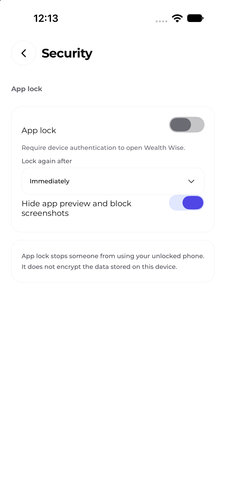</a></td>
<td><a href="https://github.com/sahilsheikh-dev/WealthWise/blob/main/docs/releases/screenshots/v1.1.0/WealthWise-v1.1.0-screenshot-profile.png">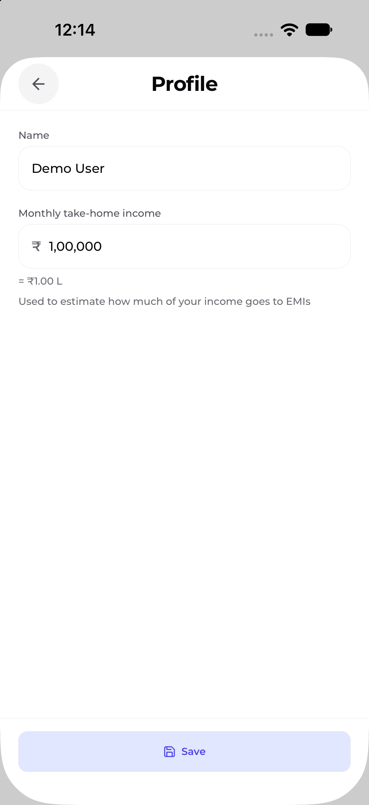</a></td>
</tr>
<tr>
<td><a href="https://github.com/sahilsheikh-dev/WealthWise/blob/main/docs/releases/screenshots/v1.1.0/WealthWise-v1.1.0-screenshot-theme.png">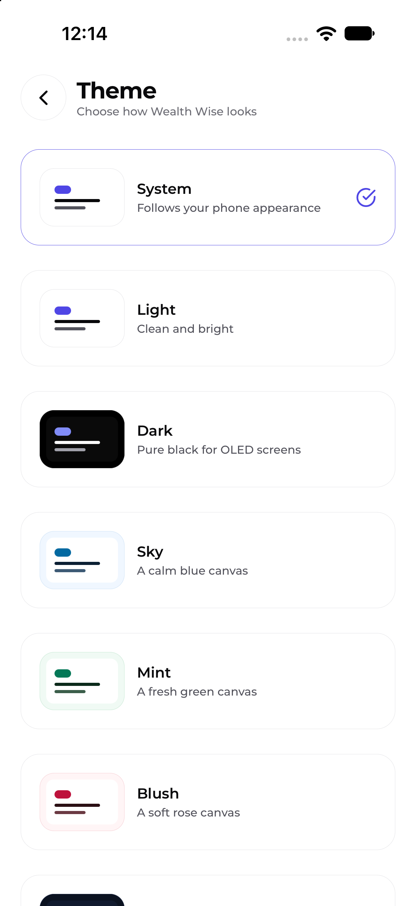</a></td>
</tr>
</table>

## What's Included

### New Features

- An aggregate actual-versus-planned Pace graph in the Budget overview.

### Improvements

- Completed and pending schedule counts in recurring investment and liability
  Entries.
- Paid history is collapsed by default, while pending schedule rows stay
  visible and stop at maturity or the final EMI.

### Fixes

- Recurring income contributes to planned amounts and dues only in its due
  months.
- Paid recurring investment and liability dues update linked records together
  and support Undo.
- Verified value edits survive app restarts.

## Breaking Changes and Migration

- None.

## Known Limitations

- iOS distribution is not available.

## Upgrade Instructions

- No special steps.

---

**Full Changelog:** [v1.1.0 changes](https://github.com/sahilsheikh-dev/WealthWise/commits/v1.1.0)
