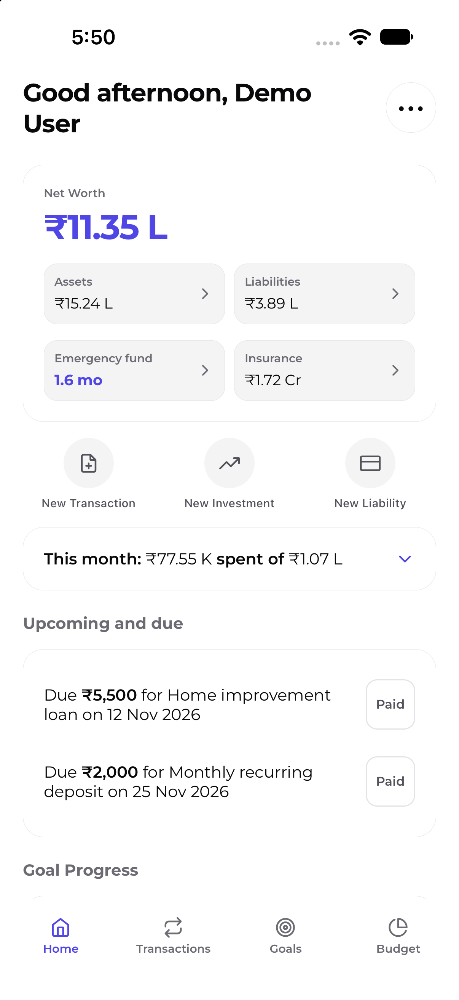
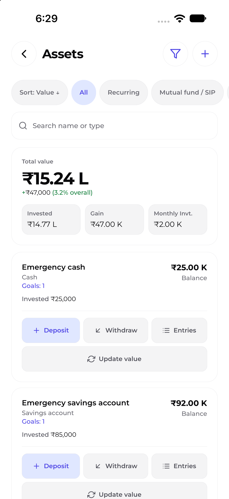
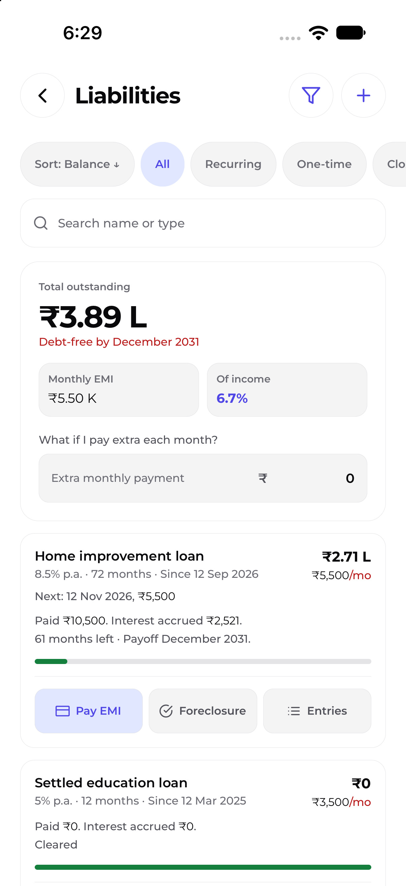
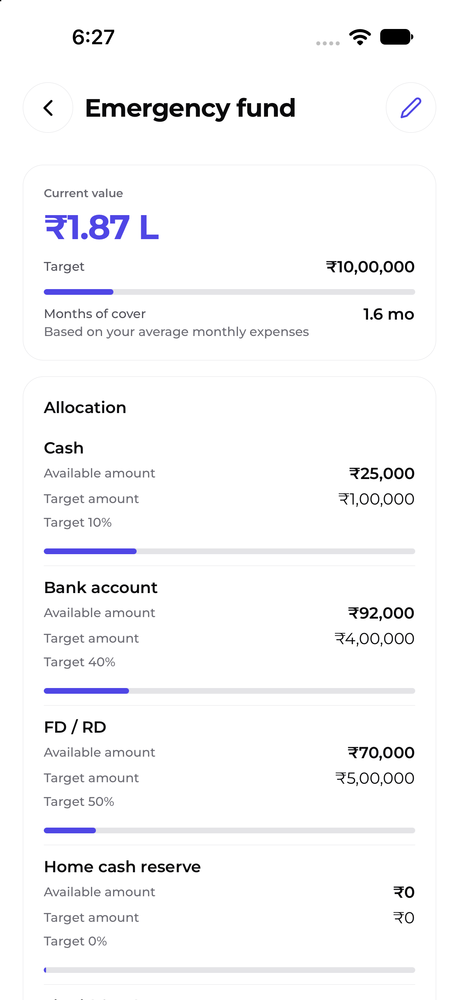
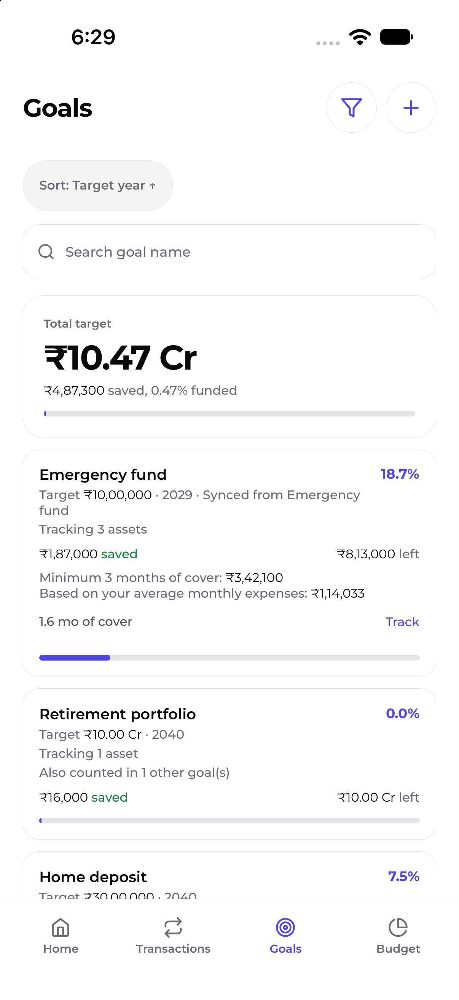
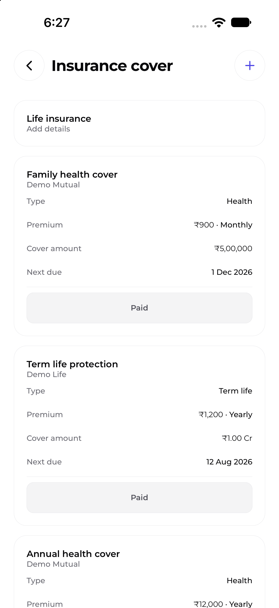
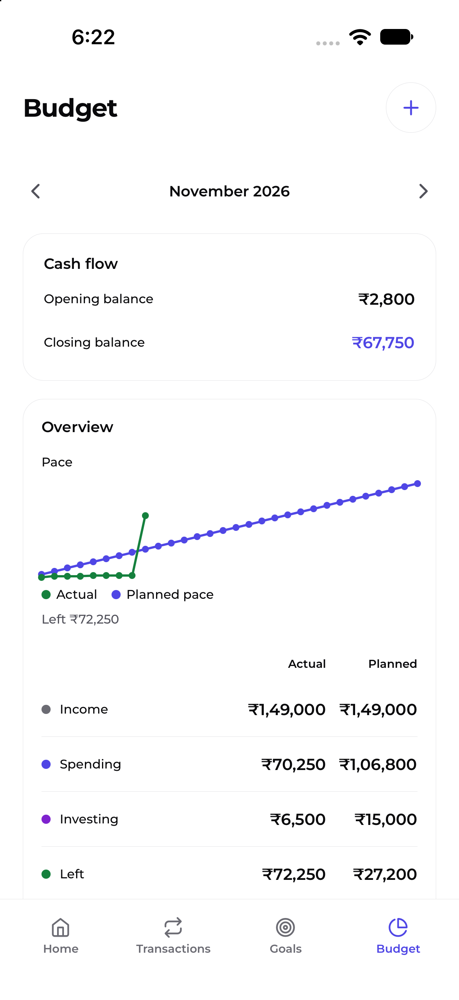
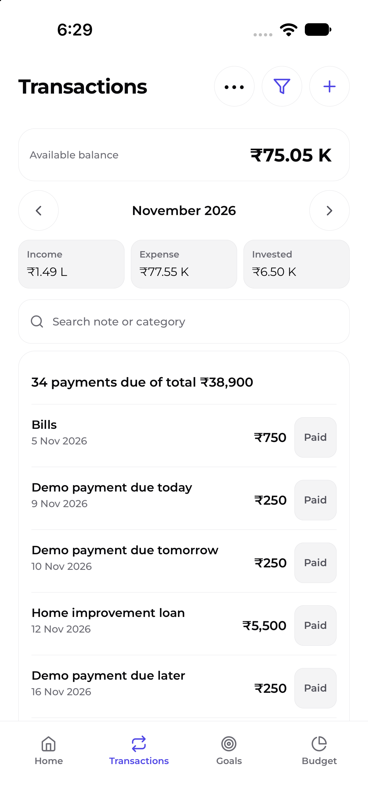

# WealthWise v1.1.1

**Release type:** Patch
**Release date:** TBD
**Git tag:** `v1.1.1`
**Previous version:** v1.1.0

## Download
Latest version: v1.1.1
Release date: TBD
- [Download the latest Android app (v1.1.1)](https://github.com/sahilsheikh-dev/WealthWise/releases/latest/download/WealthWise-android-latest-v1.1.1.apk)
- iOS: Distribution is not offered.
- [Click here to check older versions](https://github.com/sahilsheikh-dev/WealthWise/releases)
To install the APK, allow installs from this source in Android settings when prompted. This is a direct APK, not a Google Play Store-signed app.

## What's new in v1.1.1

Linked one-time savings marked Paid from Transactions now create the associated
holding entry, and Undo removes it. Shared form controls also display
consistent titles for dropdowns and inputs.

## Screenshots

<table>
<tr>
<td></td>
<td></td>
<td></td>
<td></td>
</tr>
<tr>
<td></td>
<td></td>
<td></td>
<td></td>
</tr>
</table>

## What's Included

### New Features

- None.

### Improvements

- Shared dropdown and input controls display consistent titles.

### Fixes

- Marking a linked one-time savings item Paid creates its holding entry;
  one-step Undo removes the linked changes.

## Breaking Changes and Migration

- None.

## Known Limitations

- iOS distribution is not offered.

## Upgrade Instructions

- No special steps.

---

**Full Changelog:** [v1.1.1 changes](https://github.com/sahilsheikh-dev/WealthWise/commits/v1.1.1)
