# WealthWise v1.2.0

**Release type:** Minor
**Release date:** 2026-11-11
**Git tag:** `v1.2.0`
**Previous version:** v1.1.1

## Download
Latest version: v1.2.0
Release date: 2026-11-11
- [Download the latest Android app (v1.2.0)](https://github.com/sahilsheikh-dev/WealthWise/releases/latest/download/WealthWise-android-latest-v1.2.0.apk)
- iOS: Distribution is not offered.
- [Click here to check older versions](https://github.com/sahilsheikh-dev/WealthWise/releases)
To install the APK, allow installs from this source in Android settings when prompted. This is a direct APK, not a Google Play Store-signed app.

## What's new in v1.2.0

Add Real estate and named Custom financial types, schedule one-time Budget
items, income and insurance premiums, and review completed loans and achieved
goals in separate sections. The Home menu also gains an About page with a
confirmed browser link to the latest release.

## Screenshots

The owner supplied all fourteen v1.2.0 screenshots, captured with synthetic demo
data. They are included below.

<table>
<tr>
<td><a href="https://github.com/sahilsheikh-dev/WealthWise/blob/main/docs/releases/screenshots/v1.2.0/WealthWise-v1.2.0-screenshot-home.png">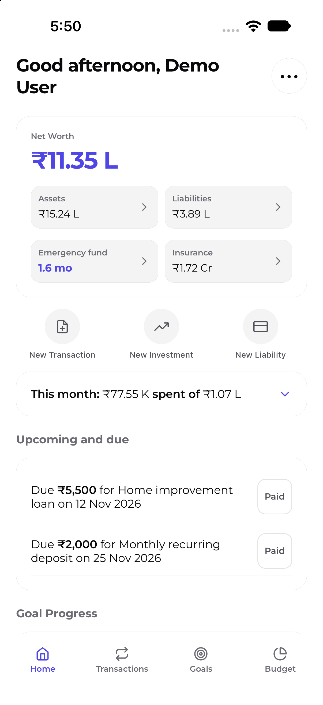</a></td>
<td><a href="https://github.com/sahilsheikh-dev/WealthWise/blob/main/docs/releases/screenshots/v1.2.0/WealthWise-v1.2.0-screenshot-assets.png">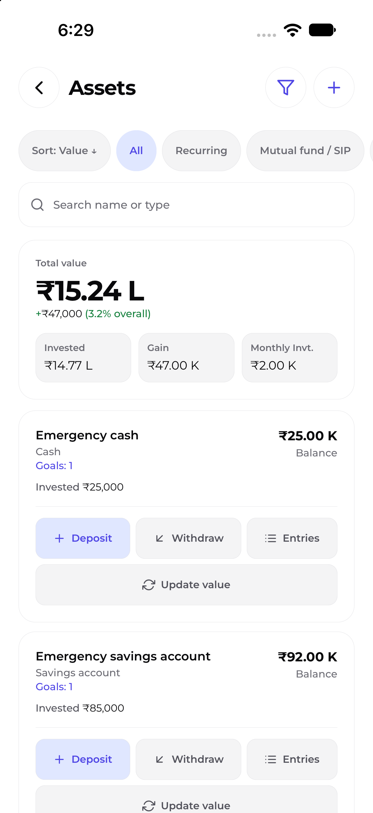</a></td>
<td><a href="https://github.com/sahilsheikh-dev/WealthWise/blob/main/docs/releases/screenshots/v1.2.0/WealthWise-v1.2.0-screenshot-liabilities.png">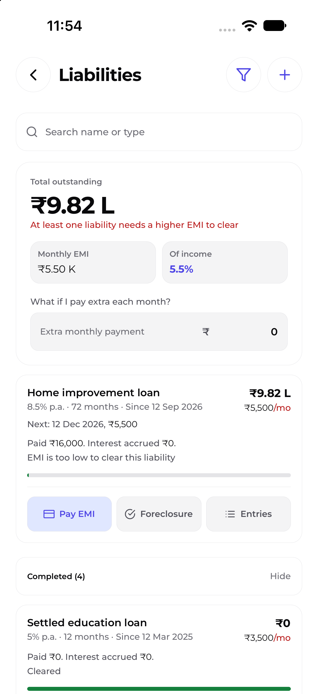</a></td>
<td><a href="https://github.com/sahilsheikh-dev/WealthWise/blob/main/docs/releases/screenshots/v1.2.0/WealthWise-v1.2.0-screenshot-emergency-fund.png">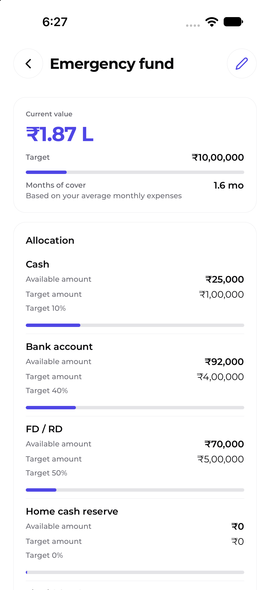</a></td>
</tr>
<tr>
<td><a href="https://github.com/sahilsheikh-dev/WealthWise/blob/main/docs/releases/screenshots/v1.2.0/WealthWise-v1.2.0-screenshot-goals.png">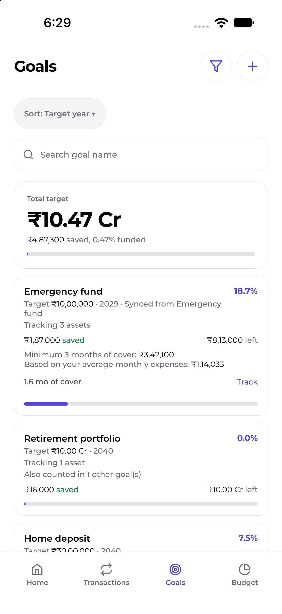</a></td>
<td><a href="https://github.com/sahilsheikh-dev/WealthWise/blob/main/docs/releases/screenshots/v1.2.0/WealthWise-v1.2.0-screenshot-insurance.png">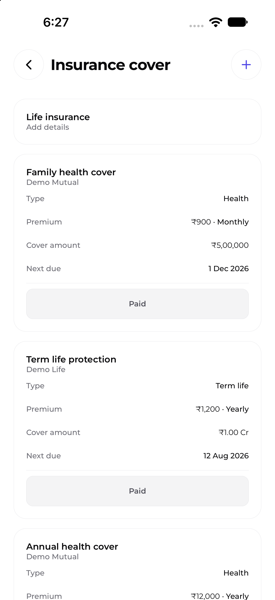</a></td>
<td><a href="https://github.com/sahilsheikh-dev/WealthWise/blob/main/docs/releases/screenshots/v1.2.0/WealthWise-v1.2.0-screenshot-budget.png">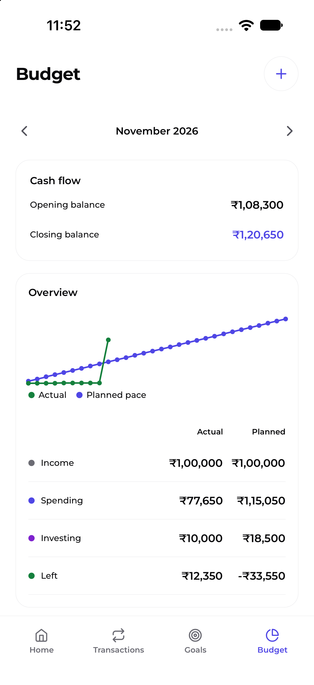</a></td>
<td><a href="https://github.com/sahilsheikh-dev/WealthWise/blob/main/docs/releases/screenshots/v1.2.0/WealthWise-v1.2.0-screenshot-transactions.png">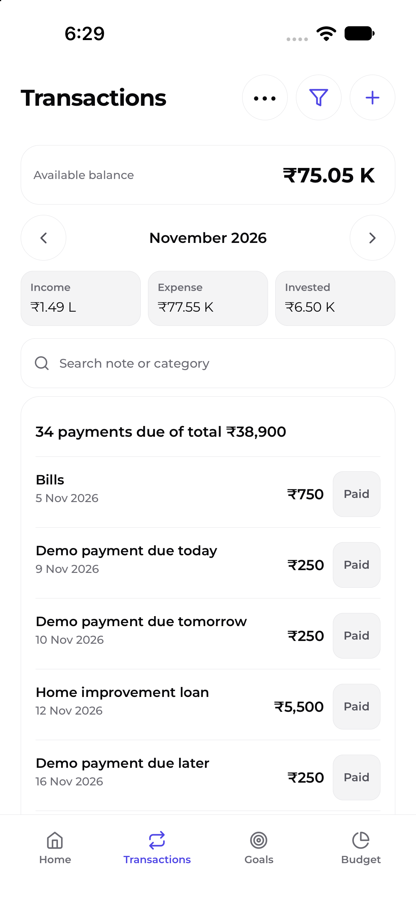</a></td>
</tr>
<tr>
<td><a href="https://github.com/sahilsheikh-dev/WealthWise/blob/main/docs/releases/screenshots/v1.2.0/WealthWise-v1.2.0-screenshot-backup-and-restore.png">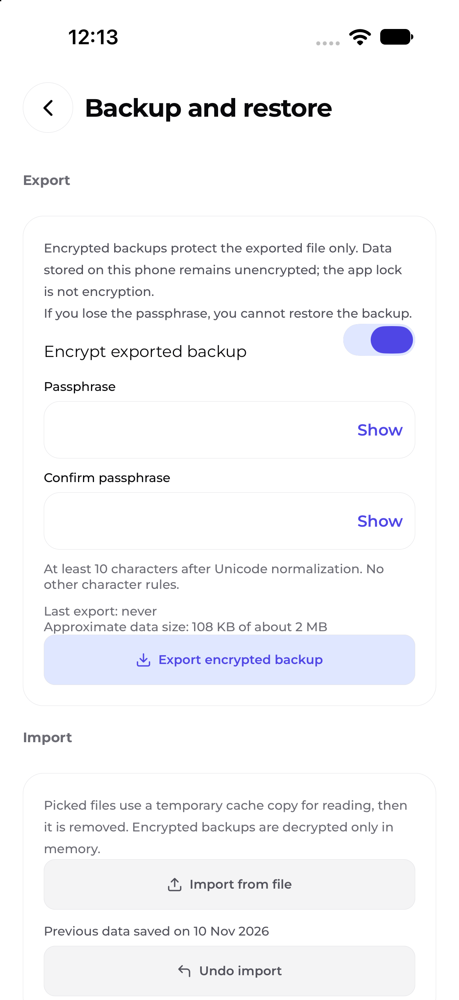</a></td>
<td><a href="https://github.com/sahilsheikh-dev/WealthWise/blob/main/docs/releases/screenshots/v1.2.0/WealthWise-v1.2.0-screenshot-reminders.png">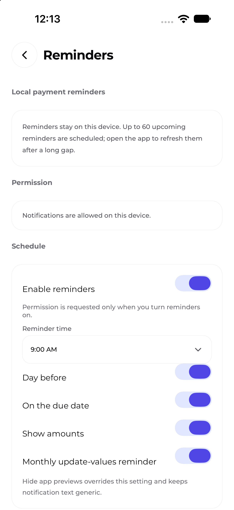</a></td>
<td><a href="https://github.com/sahilsheikh-dev/WealthWise/blob/main/docs/releases/screenshots/v1.2.0/WealthWise-v1.2.0-screenshot-security.png">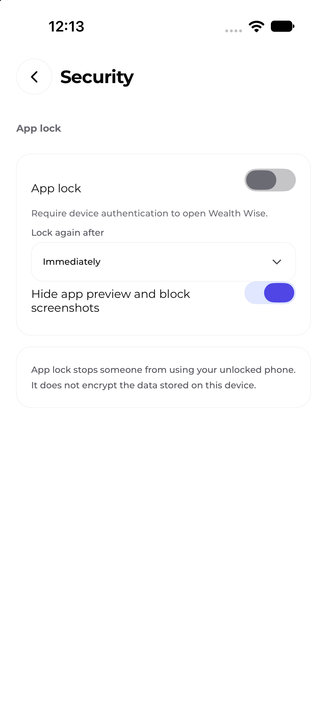</a></td>
<td><a href="https://github.com/sahilsheikh-dev/WealthWise/blob/main/docs/releases/screenshots/v1.2.0/WealthWise-v1.2.0-screenshot-profile.png">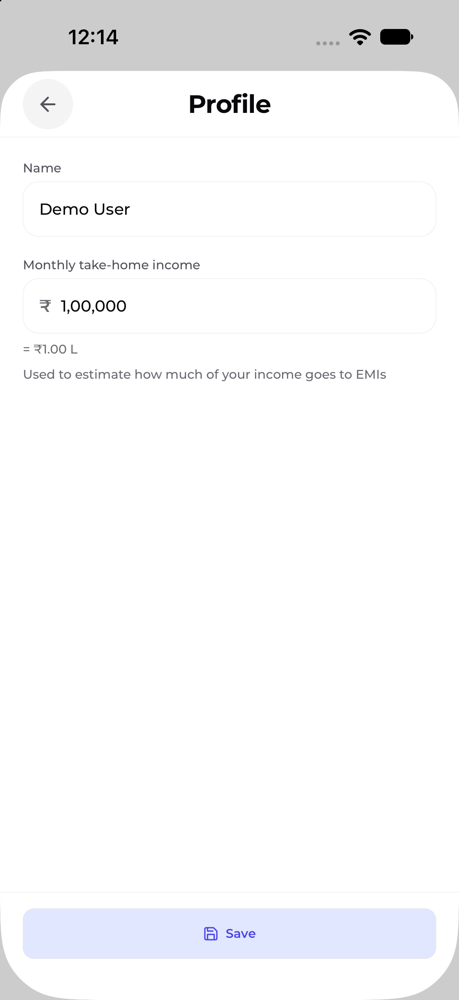</a></td>
</tr>
<tr>
<td><a href="https://github.com/sahilsheikh-dev/WealthWise/blob/main/docs/releases/screenshots/v1.2.0/WealthWise-v1.2.0-screenshot-theme.png">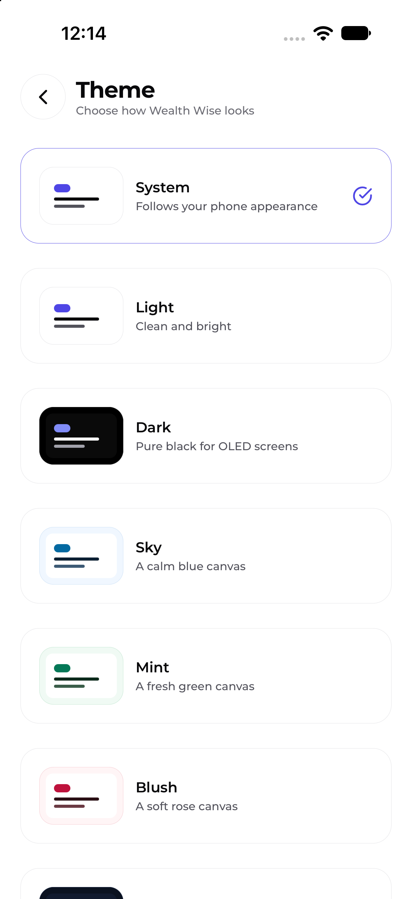</a></td>
<td><a href="https://github.com/sahilsheikh-dev/WealthWise/blob/main/docs/releases/screenshots/v1.2.0/WealthWise-v1.2.0-screenshot-about.png">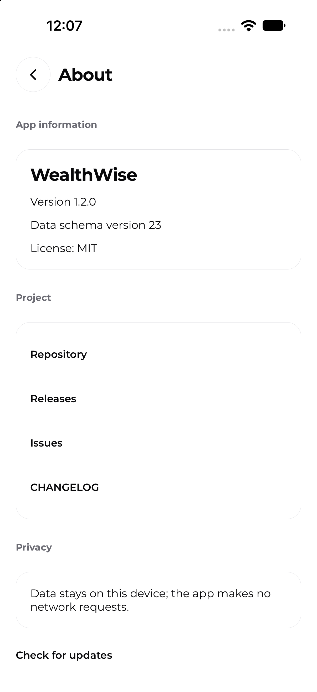</a></td>
</tr>
</table>

## What's Included

### New Features

- Add Real estate and Custom asset types, plus Custom liability types.
  Custom names are validated and displayed with the selected type.
- Schedule one-time Budget items, income and insurance premiums for a specified
  first-due month/date. They run once and do not repeat.
- View completed loans and achieved goals in labelled, initially collapsed
  sections. Existing filters remain available, and the Emergency fund goal
  stays pinned.
- Open About from the Home menu to view app and schema versions, license,
  project links and the on-device data privacy statement. Check for updates
  asks before opening the GitHub releases page in the browser; the app does
  not make an update-check request.

### Improvements

- The stress-tier picker supports all four choices.
- Budget Overview removes redundant Pace and Over by/Left summary text while
  retaining the chart, table row and accessible descriptions.

### Fixes

- None.

## Breaking Changes and Migration

- None. Existing schema v22 data migrates additively to v23. Supported
  historical backups remain importable; no manual migration is required.

## Known Limitations

- Check for updates opens the releases page in the browser; there is no
  automatic or in-app network update check.
- iOS distribution is not offered.

## Upgrade Instructions

- No special steps. As with any app update, keep a current backup before
  upgrading.

---

**Full Changelog:** [v1.2.0 changes](https://github.com/sahilsheikh-dev/WealthWise/commits/v1.2.0)
