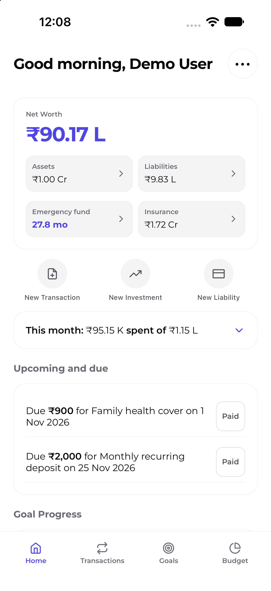
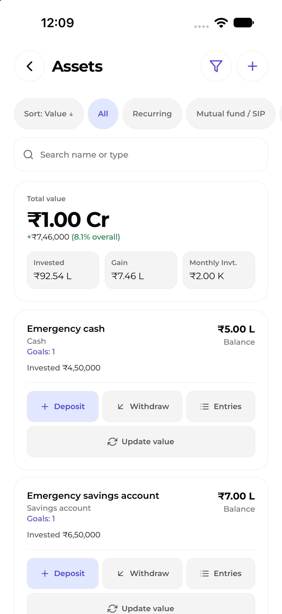
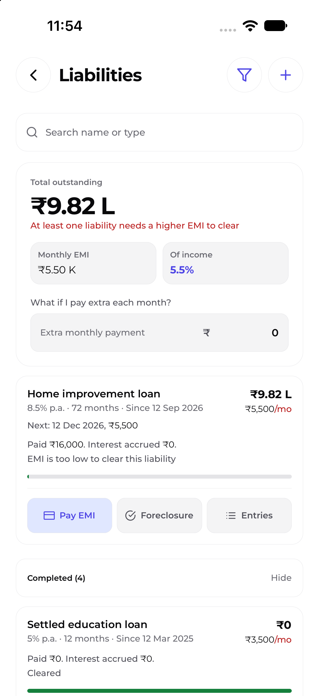
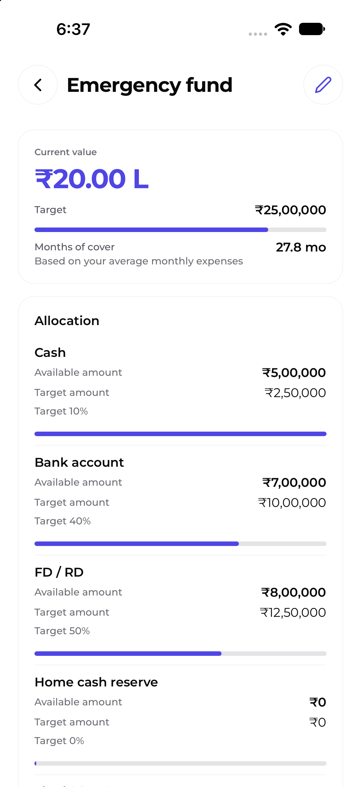
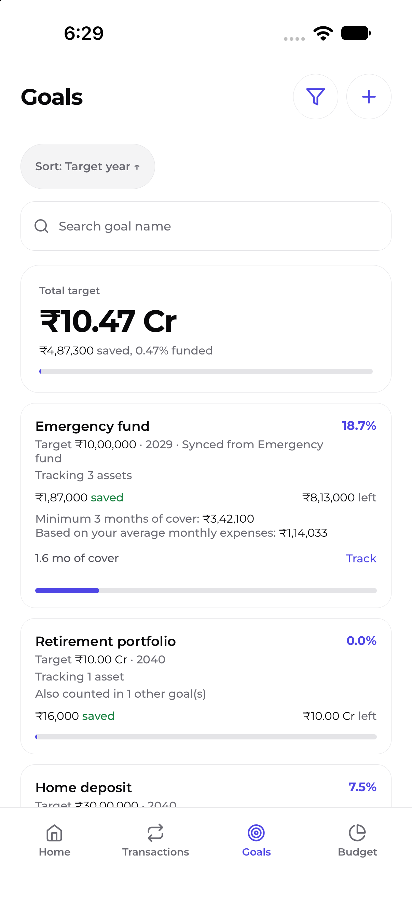
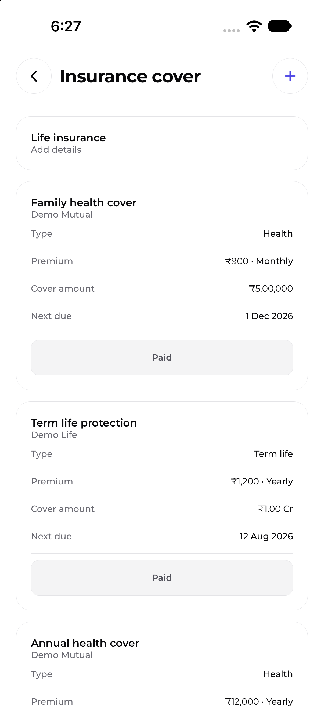
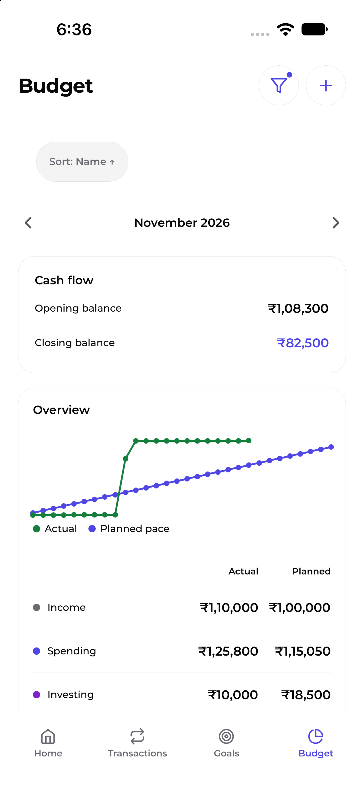
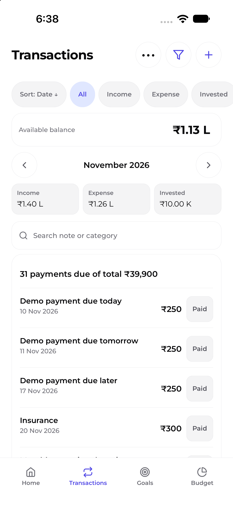

# WealthWise v1.3.0

**Release type:** Minor
**Release date:** 2026-11-22
**Git tag:** `v1.3.0`
**Previous version:** v1.2.0

## Download
Latest version: v1.3.0
Release date: 2026-11-22
- [Download the latest Android app (v1.3.0)](https://github.com/sahilsheikh-dev/WealthWise/releases/latest/download/WealthWise-android-latest-v1.3.0.apk)
- iOS: Distribution is not offered.
- [Click here to check older versions](https://github.com/sahilsheikh-dev/WealthWise/releases)
To install the APK, allow installs from this source in Android settings when prompted. This is a direct APK, not a Google Play Store-signed app.

## What's new in v1.3.0

Enjoy searchable, categorized dropdown pickers throughout the app, flexible
Budget category and item sorting, custom earned-income categories, direct
Emergency Fund target editing, customizable payment dates for dues, and
support for linking multiple investment budgets to a single asset.

## Screenshots

The owner supplied the eight core v1.3.0 screenshots, captured with synthetic demo
data. They are included below.

<table>
<tr>
<td></td>
<td></td>
<td></td>
<td></td>
</tr>
<tr>
<td></td>
<td></td>
<td></td>
<td></td>
</tr>
</table>

## What's Included

### New Features

- Searchable, categorized modal dropdown pickers across all forms, replacing flat
  lists with fast filtering, section grouping, and accessible live announcements.
- Custom earned-income categories in Budget Income and Transaction forms,
  persisted under schema version 24.
- Budget category and item sorting throughout the Budget tab, backed by a persistent
  SortChip filter control.
- Customizable payment dates and amounts when marking scheduled or budgeted items
  Paid in Transactions and Budget, defaulting to today with single-write persistence.
- Link multiple one-time investment budgets to a single asset, tracking payments
  and budget actuals independently without holding conflicts.
- Edit Emergency Fund target directly from its dedicated screen with immediate
  recalculation and synchronization across Home and Goals.
- Scoped Transaction expense categories prioritizing user-created and applicable
  scheduled items while maintaining access to historical categories when editing.

### Improvements

- Keyboard-safe modal sheets and clear search controls meeting 44x44 pt tap targets.
- Streamlined dropdown search input without duplicate header titles.

### Fixes

- None.

## Breaking Changes and Migration

- None. Existing schema v23 data automatically migrates to schema v24 upon launch.
  Historical backup import and plain/encrypted export formats remain fully compatible.

## Known Limitations

- Check for updates opens the releases page in the browser; there is no automatic
  or in-app network update check.
- iOS distribution is not offered.

## Upgrade Instructions

- No special steps. As with any app update, keep a current backup before
  upgrading.

---

**Full Changelog:** [v1.3.0 changes](https://github.com/sahilsheikh-dev/WealthWise/commits/v1.3.0)
