# WealthWise v1.4.0

**Release type:** Minor
**Release date:** 2026-11-25
**Git tag:** `v1.4.0`
**Previous version:** v1.3.0

## Download
Latest version: v1.4.0
Release date: 2026-11-25
- [Download the latest Android app (v1.4.0)](https://github.com/sahilsheikh-dev/WealthWise/releases/latest/download/WealthWise-android-latest-v1.4.0.apk)
- iOS: Distribution is not offered.
- [Click here to check older versions](https://github.com/sahilsheikh-dev/WealthWise/releases)
To install the APK, allow installs from this source in Android settings when prompted. This is a direct APK, not a Google Play Store-signed app.

## What's new in v1.4.0

WealthWise v1.4.0 introduces dynamic asset valuation methods, a dynamic Budget
category filter, Goals status and target-year filtering, persistent per-screen
sorting, reliable Budget rename category syncing, and an upgrade to Expo SDK 58
with security and deep-link hardening.

## Screenshots

The owner supplied the 13 v1.4.0 screenshots, captured with synthetic demo
data. They are included below.

<table>
<tr>
<td><a href="https://github.com/sahilsheikh-dev/WealthWise/blob/main/docs/releases/screenshots/v1.4.0/WealthWise-v1.4.0-screenshot-home.png">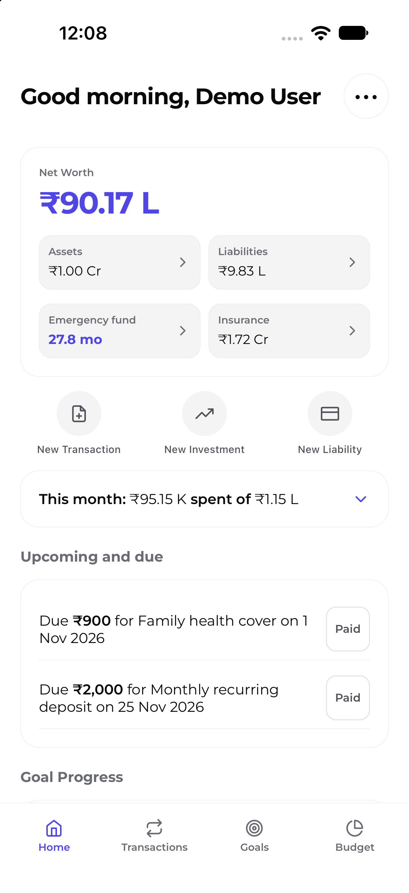</a></td>
<td><a href="https://github.com/sahilsheikh-dev/WealthWise/blob/main/docs/releases/screenshots/v1.4.0/WealthWise-v1.4.0-screenshot-assets.png">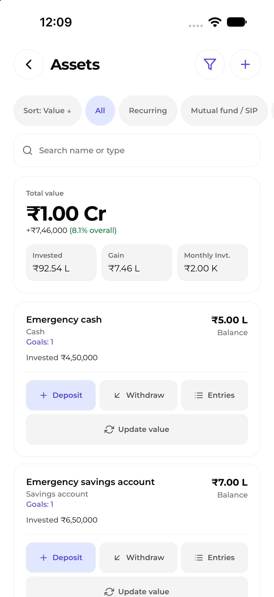</a></td>
<td><a href="https://github.com/sahilsheikh-dev/WealthWise/blob/main/docs/releases/screenshots/v1.4.0/WealthWise-v1.4.0-screenshot-liabilities.png">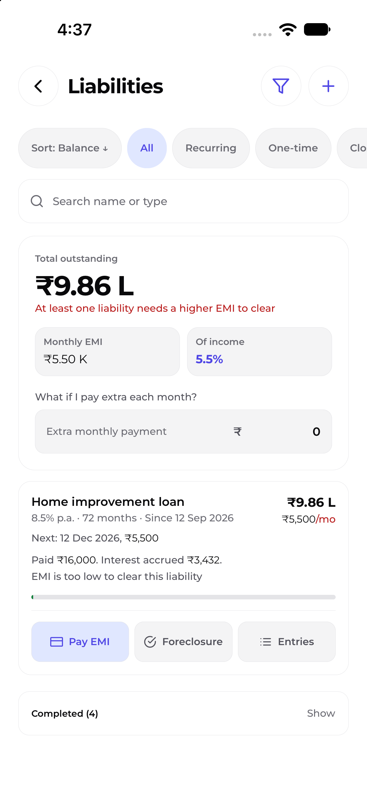</a></td>
<td><a href="https://github.com/sahilsheikh-dev/WealthWise/blob/main/docs/releases/screenshots/v1.4.0/WealthWise-v1.4.0-screenshot-emergency-fund.png">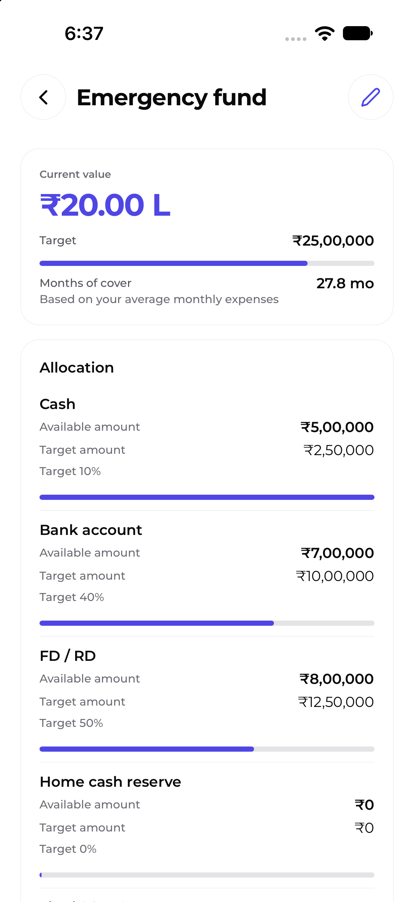</a></td>
</tr>
<tr>
<td><a href="https://github.com/sahilsheikh-dev/WealthWise/blob/main/docs/releases/screenshots/v1.4.0/WealthWise-v1.4.0-screenshot-goals.png">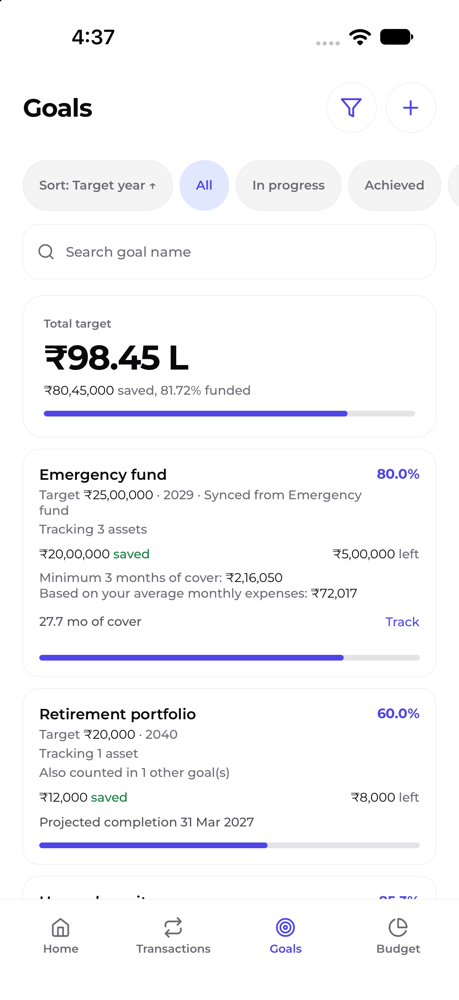</a></td>
<td><a href="https://github.com/sahilsheikh-dev/WealthWise/blob/main/docs/releases/screenshots/v1.4.0/WealthWise-v1.4.0-screenshot-insurance.png">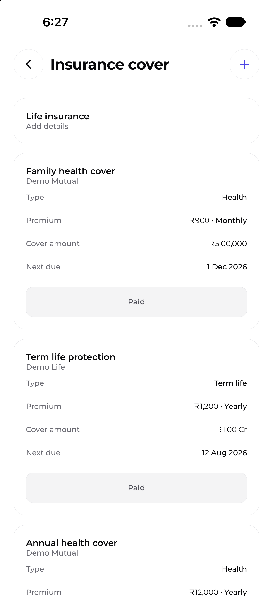</a></td>
<td><a href="https://github.com/sahilsheikh-dev/WealthWise/blob/main/docs/releases/screenshots/v1.4.0/WealthWise-v1.4.0-screenshot-budget.png">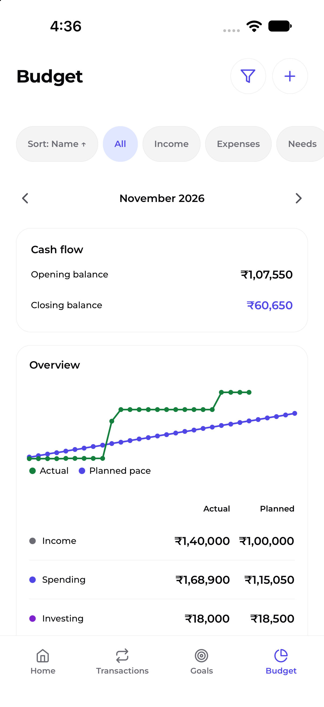</a></td>
<td><a href="https://github.com/sahilsheikh-dev/WealthWise/blob/main/docs/releases/screenshots/v1.4.0/WealthWise-v1.4.0-screenshot-transactions.png">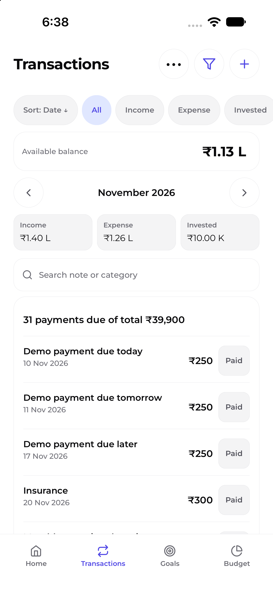</a></td>
</tr>
<tr>
<td><a href="https://github.com/sahilsheikh-dev/WealthWise/blob/main/docs/releases/screenshots/v1.4.0/WealthWise-v1.4.0-screenshot-backup-and-restore.png">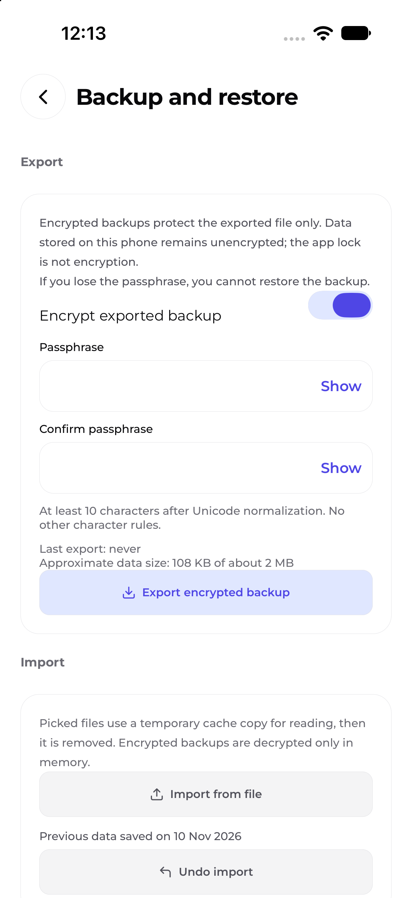</a></td>
<td><a href="https://github.com/sahilsheikh-dev/WealthWise/blob/main/docs/releases/screenshots/v1.4.0/WealthWise-v1.4.0-screenshot-reminders.png">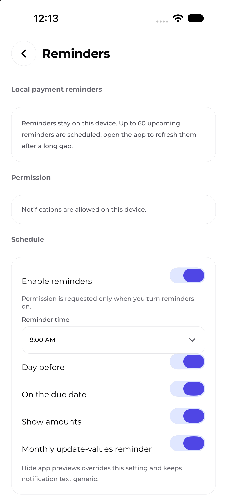</a></td>
<td><a href="https://github.com/sahilsheikh-dev/WealthWise/blob/main/docs/releases/screenshots/v1.4.0/WealthWise-v1.4.0-screenshot-security.png">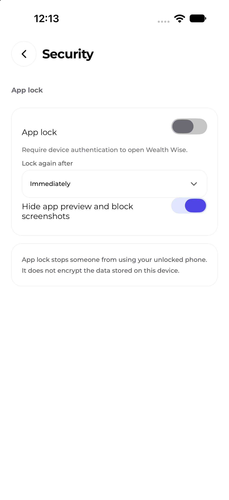</a></td>
<td><a href="https://github.com/sahilsheikh-dev/WealthWise/blob/main/docs/releases/screenshots/v1.4.0/WealthWise-v1.4.0-screenshot-profile.png">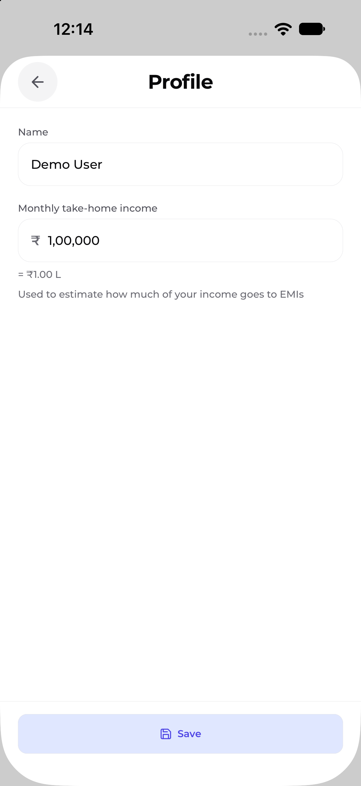</a></td>
</tr>
<tr>
<td><a href="https://github.com/sahilsheikh-dev/WealthWise/blob/main/docs/releases/screenshots/v1.4.0/WealthWise-v1.4.0-screenshot-theme.png">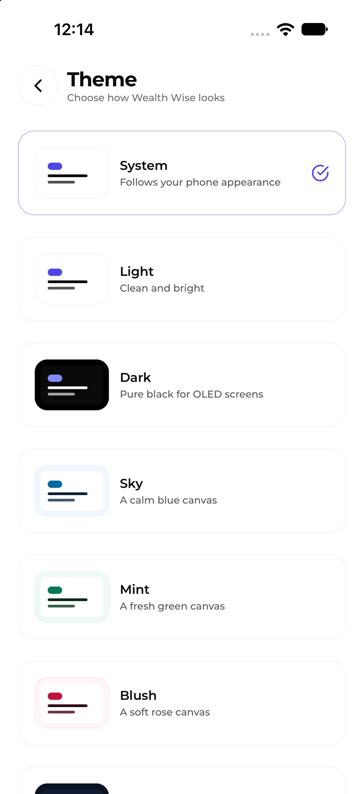</a></td>
</tr>
</table>

## What's Included

### New Features

- Dynamic asset valuation methods across one-time and recurring holdings:
  Manual, Interest-based (rate and compounding), Unit-based (auto-calculated
  units and total value), and Balance-based, with live form inputs and
  valuation updates.
- Dynamic Budget category filter in the Budget filter panel alongside `SortChip`,
  listing available categories (including custom categories) and persisting
  across month navigation.
- Goals filter panel with status (`All`, `In progress`, `Achieved`) and dynamic
  target-year filter chips alongside `SortChip`.
- Persistent per-screen sorting preferences across Transactions, Assets,
  Liabilities, Goals, and Budget.

### Improvements

- Upgraded runtime platform to Expo SDK 58 (`react-native@0.88.1`,
  `expo-router@~58.0.32`), resolving the `decode-uri-component` transitive
  advisory.
- Consistent filter panels across Goals, Assets, Liabilities, Transactions, and
  Budget without header filter-icon dot indicators.
- Non-intrusive SQLite fallback warning banner when storage falls back to
  AsyncStorage, accurately confirming preserved local data.
- Excluded development stress-data generators from production Hermes bundles
  while keeping Demo Mode intact.

### Fixes

- Renaming a Budget item or section across single-month or following scopes now
  updates linked transaction category names while preserving transaction amount,
  date, budget link, and custom user notes.
- Added explicit modal route registrations for `ef-allocation-form`,
  `holding-valuation-form`, `liability-closure-form`,
  `liability-closure-note-form`, and `recurring-plan-stop-form`, plus safe
  fallback handling for missing or invalid `wealthwise://` deep-link
  parameters.

## Breaking Changes and Migration

- None. Local data remains on schema version 24, and plain/encrypted backups
  remain fully compatible.

## Known Limitations

- Check for updates opens the releases page in the browser; there is no automatic
  or in-app network update check.
- iOS distribution is not offered.

## Upgrade Instructions

- No special steps. As with any app update, keep a current backup before
  upgrading.

---

**Full Changelog:** [v1.4.0 changes](https://github.com/sahilsheikh-dev/WealthWise/commits/v1.4.0)
